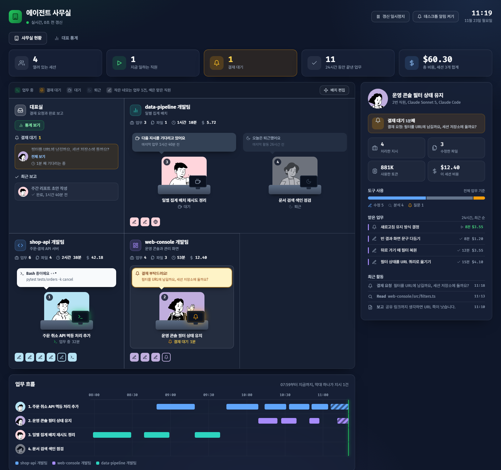
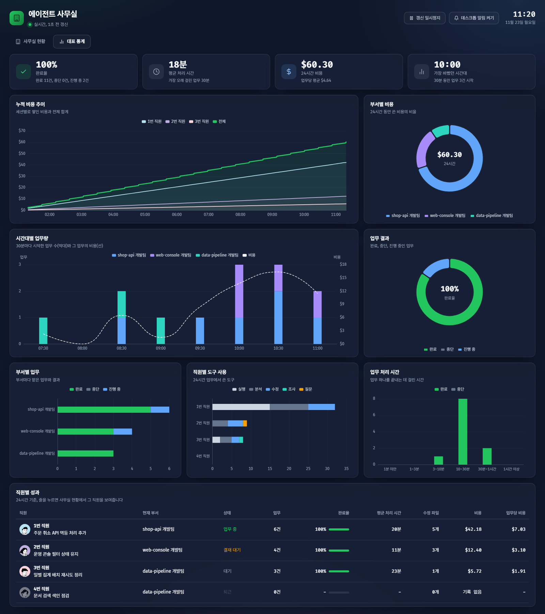

# 에이전트 사무실

여러 AI 에이전트 세션을 동시에 돌릴 때, 누가 지금 무슨 일을 하고 있는지 한 화면에서 보는 로컬 대시보드입니다.
Orca에서 열어 둔 세션을 회사 직원처럼 보여 줍니다. 작업한 프로젝트에 따라 부서를 나누고, 비용과 업무 통계는 대표 화면에서 차트로 확인합니다.





> 화면에 나오는 프로젝트와 업무는 기능을 보여 주기 위한 예시입니다.

## 주요 기능

### 사무실 현황

- **부서 배치도**: 업무(지시 1건)마다 어느 프로젝트 폴더에서 일했는지 보고 부서를 나눕니다. 한 세션이 여러 부서에서 일했다면 여러 방에 업무가 나뉘어 보입니다.
- **직원과 말풍선**: 세션마다 일러스트 직원이 책상에 앉아 있고, 지금 하는 일을 말풍선으로 알려 줍니다. 예를 들면 "theme.py 고치는 중이에요"나 "결재 부탁드려요!" 같은 식입니다.
- **상태에 따라 바뀌는 모습**: 결재를 기다리면 손을 흔들고, 쉬는 중이면 휴대폰을 보고, 세션이 꺼지면 회색으로 바뀝니다.
- **대표실**: 내 답을 기다리는 질문(결재 대기)과 방금 끝난 업무 보고가 모입니다.
- **업무 흐름**: 직원별로 언제 어떤 부서 일을 했는지 시간 막대로 보여 줍니다.
- **비용**: 전체 합계, 세션별 비용, 부서별 비용, 업무 1건당 비용을 보여 줍니다.
- **업무 일지**: 직원이나 업무를 누르면 지시 내용, 보고, 수정한 파일, 도구 사용 비율, 최근 활동이 나옵니다.
- **알림**: 세션이 새로 열리거나 닫히면 화면에 알려 주고, 원하면 결재 요청과 완료 보고를 데스크톱 알림으로 받을 수 있습니다.

### 대표 통계

[Apache ECharts](https://echarts.apache.org)로 그린 차트로 최근 24시간을 봅니다.

- 완료율, 평균 처리 시간, 24시간 비용, 가장 바빴던 시간대
- 누적 비용 추이 (세션별, 전체)
- 부서별 비용 비율
- 30분 단위 업무량과 비용
- 업무 결과 (완료, 중단, 진행 중)
- 부서별 업무 수와 결과
- 직원별 도구 사용
- 업무 처리 시간 분포
- 직원별 성과표 (업무 수, 완료율, 평균 처리 시간, 수정 파일, 비용, 업무당 비용)

## 실행 방법

### 준비물

- Windows
- Python 3.9 이상 (추가 패키지는 필요 없습니다)
- Orca 1.4.25x 이상 (최신 v5 세션 저널도 읽습니다)
- 비용은 Claude Code가 남기는 토큰 기록과 `pricing.json`의 API 가격으로 계산합니다. OpenCode 기록이 있으면 그 비용을 먼저 씁니다.

### 실행

`start.bat`을 더블클릭하면 서버가 켜지고 브라우저에서 `http://127.0.0.1:8765/`가 열립니다.

직접 실행하려면 다음처럼 입력합니다.

```powershell
py -3 server.py              # 기본 포트 8765, 브라우저 자동 열기
py -3 server.py 9000         # 포트 지정
py -3 server.py --no-browser # 브라우저를 열지 않음
```

이미 켜져 있을 때 다시 실행하면 서버를 하나 더 띄우지 않고 브라우저만 엽니다. 다른 프로그램이 포트를 쓰고 있으면 다음 번호를 자동으로 찾습니다. 끄려면 작업 표시줄에 최소화된 "Agent Office" 창을 닫으면 됩니다.

### 원격 Orca 호스트에서 실행

세션이 다른 컴퓨터(예: SSH로 붙는 원격 서버)의 Orca에서 돌고 있다면, 그 호스트에서 대시보드를 켜고 이 PC로 SSH 터널만 열면 됩니다. `start-remote.bat`이 세 가지를 한 번에 합니다.

```bat
set HOST=me@my-orca-host        rem 세션이 돌고 있는 Orca 호스트
set RPORT=18765                 rem 원격에서 쓸 포트
set LPORT=8766                  rem 이 PC에서 열 포트
```

1. 원격 호스트의 `~/agent-office`에 이 폴더를 복사해 둡니다.
2. `start-remote.bat`을 더블클릭합니다.
3. 원격에서 `python3 server.py 18765 --no-browser`가 켜지고, `ssh -L 8766:127.0.0.1:18765` 터널이 열린 뒤 브라우저에서 `http://127.0.0.1:8766/`이 열립니다.

원격 호스트는 리눅스라 `~/.orca`와 `~/.claude` 기록을 읽습니다. 원격 서버는 이미 켜져 있으면 새로 띄우지 않습니다.

### 바탕화면 바로가기

PowerShell에서 아래를 실행하면 녹색 건물 아이콘의 "에이전트 사무실" 바로가기가 바탕화면에 생깁니다.

```powershell
$dir = "C:\경로\agent-office"   # 이 저장소를 받은 폴더
$s = (New-Object -ComObject WScript.Shell).CreateShortcut("$([Environment]::GetFolderPath('Desktop'))\에이전트 사무실.lnk")
$s.TargetPath = "$dir\start.bat"; $s.WorkingDirectory = $dir; $s.IconLocation = "$dir\agent-office.ico,0"; $s.WindowStyle = 7
$s.Save()
```

## 배치 바꾸기

사무실 화면 위쪽의 **배치 편집**을 누르면 편집 모드가 됩니다.

- **옮기기**: 방을 끌어다 원하는 자리에 놓습니다. 키보드로는 방마다 있는 ◀ ▶ 버튼을 씁니다. 대표실도 옮길 수 있습니다.
- **이름 바꾸기**: 연필 버튼으로 부서 이름과 설명을 바꿉니다. 비워 두고 저장하면 기본값으로 돌아갑니다.
- **숨기기**: 눈 버튼을 누르면 사무실 화면에서만 빠집니다. 통계와 비용에는 그대로 들어갑니다. 아래 "숨긴 부서" 목록에서 다시 보이게 할 수 있습니다.
- **지우기**: 휴지통 버튼을 누르고 업무를 옮길 부서를 고르면, 그 부서의 업무가 모두 고른 부서로 합쳐집니다. 아래 "지운 부서" 목록에서 되살릴 수 있습니다.
- **기본 배치로**: 직접 정한 순서를 지우고 자동 배치(직원이 있는 방, 프로젝트, 지원 부서 순)로 돌아갑니다.

편집하는 동안에는 끌어 옮기기가 끊기지 않도록 사무실 화면 갱신이 잠시 멈춥니다. **편집 끝내기**나 Esc 키로 끝냅니다. 바꾼 내용은 `departments.json`에 저장되어 다른 브라우저와 다음 실행에도 그대로 남습니다.

## 부서 설정 파일

`departments.json`에서 부서 이름, 설명, 아이콘, 색을 직접 정할 수도 있습니다. 파일을 저장하면 다음 갱신(2초) 때 바로 반영됩니다. 배치 편집에서 바꾼 내용은 `order`(순서), `hidden`(숨김), `mergeInto`(지운 부서의 업무를 옮긴 곳)로 저장됩니다.

```json
{
  "shop-api": {
    "name": "쇼핑몰 API 팀",
    "mission": "주문과 결제를 처리하는 서버",
    "icon": "code",
    "color": "#60A5FA"
  }
}
```

- **키**: 홈 폴더 바로 아래의 프로젝트 폴더 이름입니다(예: `C:\Users\나\shop-api` → `shop-api`). 설정에 없는 프로젝트는 "`폴더이름` 개발팀"으로 자동으로 만들어지고, 설명은 그 프로젝트 README의 첫 제목을 씁니다.
- **기본 부서**: 프로젝트 폴더와 상관없는 업무는 아래 부서로 갑니다.

| 키 | 기본 이름 | 들어가는 업무 |
|---|---|---|
| `_ops` | IT 인프라팀 | 프로그램 설치, 환경 설정, 파일 정리처럼 시스템 폴더에서 한 일 |
| `_research` | 리서치센터 | 주로 웹 검색과 문서 읽기만 한 일 |
| `_desk` | 질의응답 데스크 | 도구를 쓰지 않고 바로 답한 질문 |
| `_new` | 입사 대기실 | 아직 첫 지시를 받지 않은 세션 |

- **아이콘**: `camera`, `image`, `layout`, `shield`, `wrench`, `book`, `help`, `users`, `code`, `chart`, `briefcase`, `files`, `globe`, `terminal` 중에서 고릅니다.

## 상태 표시

| 상태 | 뜻 |
|---|---|
| 업무 중 | 명령 실행, 파일 수정, 검색 같은 도구를 쓰는 중 |
| 검토 중 | 다음에 할 일을 생각하는 중 |
| 보고 작성 중 | 결과를 답변으로 쓰는 중 |
| 결재 대기 | 나에게 질문을 보내고 답을 기다리는 중 |
| 대기 | 업무를 끝내고 다음 지시를 기다리는 중 |
| 퇴근 | 세션 프로세스가 꺼진 상태 |

## 동작 방식

- Orca의 세션 기록(`%APPDATA%\orca\agent-session-journal.db`, 없으면 `agent-session-domain.db`)을 **읽기 전용**으로 엽니다. 최신 Orca가 쓰는 v5 저널(`journal_outcomes`)은 메모리에서 기존 표 모양으로 풀어서 읽고, 바뀐 줄만 이어서 반영합니다.
- 비용은 Claude Code가 세션마다 남기는 `~/.claude/projects/*/<세션>.jsonl`의 토큰 사용량에 API 가격을 곱해 계산합니다. 가격표는 `pricing.json`(100만 토큰당 입력·출력·캐시 쓰기·캐시 읽기)에 있고, 서버가 켜질 때 LiteLLM 공개 가격표를 한 번 받아 최신 모델 가격으로 갱신합니다. 인터넷이 없으면 `pricing.json`만 씁니다.
- OpenCode 기록(`~/.local/share/opencode/opencode.db`)이 있으면 그쪽에 적힌 비용을 먼저 씁니다.
- Orca에서 탭으로 열려 있는 세션만 보여 줍니다. 세션을 닫거나 지우면 사무실에서도 바로 빠집니다.
- 업무 1건은 내가 보낸 지시 1건입니다. 그 업무에서 쓴 명령어와 수정한 파일 경로를 보고, 가장 많이 다룬 프로젝트 폴더를 부서로 정합니다. 다른 폴더를 한두 번 스쳐 간 정도로는 하던 프로젝트에서 부서를 옮기지 않습니다.
- 결재 요청에 질문이 여러 개 있으면 질문 수와 제목을 모두 보여 줍니다.
- 상태는 1초 동안 모든 탭이 같이 쓰고, 세션 기록이 바뀐 경우에만 다시 읽습니다. 바뀐 게 없으면 데이터를 다시 보내지 않고, 보낼 때는 압축해서 보냅니다.
- 브라우저 탭이 뒤에 있을 때는 10초마다만 확인합니다(데스크톱 알림은 계속 옵니다).

## 개인 정보

- 서버는 `127.0.0.1`에서만 열리므로 같은 컴퓨터에서만 볼 수 있습니다. 주소가 `127.0.0.1`이나 `localhost`가 아닌 요청은 거절해서, 악성 웹페이지가 DNS 리바인딩으로 내용을 읽어 가는 것도 막습니다.
- Orca와 OpenCode 기록은 읽기만 하고 고치지 않습니다. 이 프로그램이 쓰는 파일은 `departments.json`뿐입니다.
- 배치 편집 저장은 이 페이지에서 보낸 요청만 받습니다(전용 헤더와 Origin 확인). 다른 웹사이트가 몰래 설정을 바꿀 수 없습니다.
- 지시나 명령어에 `pw:`, `password`, `비밀번호`, `token` 같은 형태로 들어간 값과 비밀번호처럼 보이는 문자열은 화면에서 `••••`로 가립니다. 모든 비밀 정보를 잡아내지는 못하므로, 비밀번호는 되도록 지시에 직접 쓰지 마세요.
- 직원 그림은 처음 한 번 DiceBear에서 받아 `avatars/` 폴더에, 차트 라이브러리는 `vendor/` 폴더에 저장합니다. 두 폴더는 Git에 올라가지 않습니다.

## 한계

- Codex 세션은 토큰 사용량 기록 형식이 달라 비용이 "기록 없음"으로 나옵니다.
- 가격표에 없는 새 모델은 이름으로 가장 비슷한 모델(opus·sonnet·haiku 등)의 가격을 씁니다.
- Orca 내부 기록 형식이 바뀌면 일부 정보가 안 보일 수 있습니다.
- 통계와 업무 목록은 최근 24시간을 기준으로 합니다.
- 차트 라이브러리와 직원 그림은 처음 한 번만 인터넷에서 받고, 그 뒤로는 저장해 둔 파일을 씁니다. 글꼴은 매번 인터넷에서 불러오므로, 오프라인이면 기본 글꼴(맑은 고딕)로 보입니다.

## 파일 구조

```
agent-office/
├─ server.py         # 데이터 수집과 웹 서버 (Python 표준 라이브러리만 사용)
├─ index.html        # 화면 전체 (HTML, CSS, JavaScript 한 파일)
├─ departments.json  # 부서 이름, 설명, 아이콘, 색
├─ pricing.json      # 모델별 API 가격 (100만 토큰당 USD)
├─ start.bat         # 이 PC에서 더블클릭 실행
├─ start-remote.bat  # 원격 Orca 호스트 실행 + SSH 터널
└─ docs/             # README 스크린샷
```

## 사용한 오픈소스와 디자인

- [Apache ECharts](https://echarts.apache.org) (Apache-2.0): 대표 통계 차트
- [DiceBear](https://www.dicebear.com) "Notionists" 스타일 (작가 Zoish, CC0 1.0): 직원 그림
- [Fira Sans, Fira Code](https://github.com/mozilla/Fira) (OFL), [Pretendard](https://github.com/orioncactus/pretendard) (OFL): 글꼴
- 아이콘 모양은 [Lucide](https://lucide.dev) (ISC)를 참고했습니다.
- 디자인 시스템은 [UI UX Pro Max](https://github.com/nextlevelbuilder/ui-ux-pro-max-skill)가 "사내 운영 대시보드"용으로 추천한 구성(어두운 글래스모피즘, 상태 색 초록과 주황, Fira 글꼴)을 따랐습니다.
